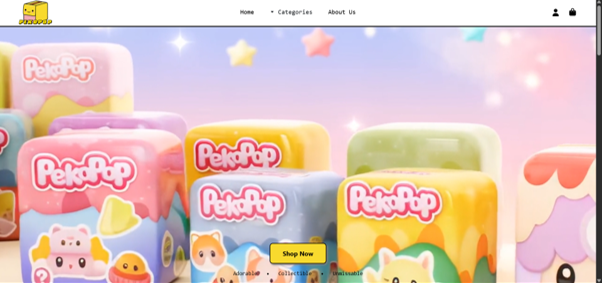
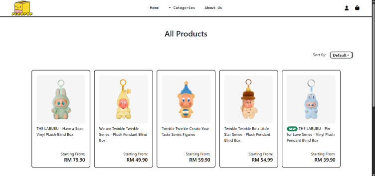
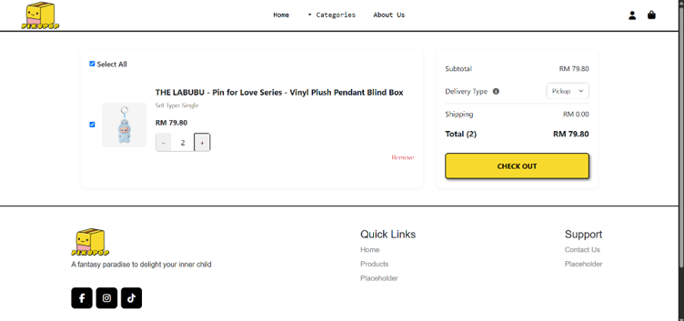
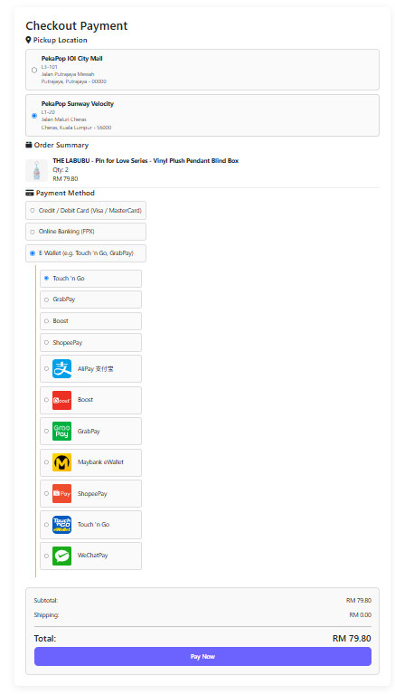

# 🍡 Pekopop

### *A little shop, a little pop of happiness! ♡*

Pekopop is a blinkbox shopping website built for fun during my semester break. A personal project where I explored web development and created a simple online shopping experience.

---

## 🌷 Features

- 🛍️ Product Listing
- 🎀 Product Details
- 🛒 Shopping Cart
- 🔍 Product Search
- 🏷️ Product Categories & Filters
- 👤 User Login & Registration
- 💳 Checkout Page

## 💻 Languages Used

- PHP
- JavaScript
- CSS

## 📸 Website Preview

### 🏠 Homepage


### 🛍️ Product Listing


### 🛒 Shopping Cart


### 💳 Checkout Page


---

## ⚙️ Getting Started

### Prerequisites

- PHP
- XAMPP (or another local server environment)
- Web browser

### Installation

**1. Clone the repository**

```bash
git clone https://github.com/munonn0624/PekoPop
```

**2. Navigate to the project folder**

```bash
cd PekoPop
```

**3. Set up the local server**

- Move the project folder into `C:/xampp/htdocs/`.
- Start Apache and MySQL in XAMPP.
- Configure the database and import the SQL file, if required.

**4. Open the website**

Visit the following URL in your browser:

```text
http://localhost/PekoPop
```

---

<p align="center">
  <sub>Note: This project is still a work in progress.</sub>
</p>
